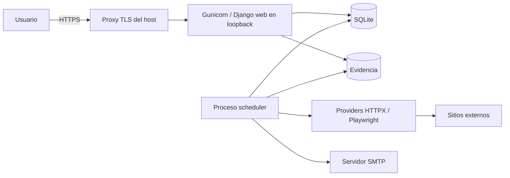
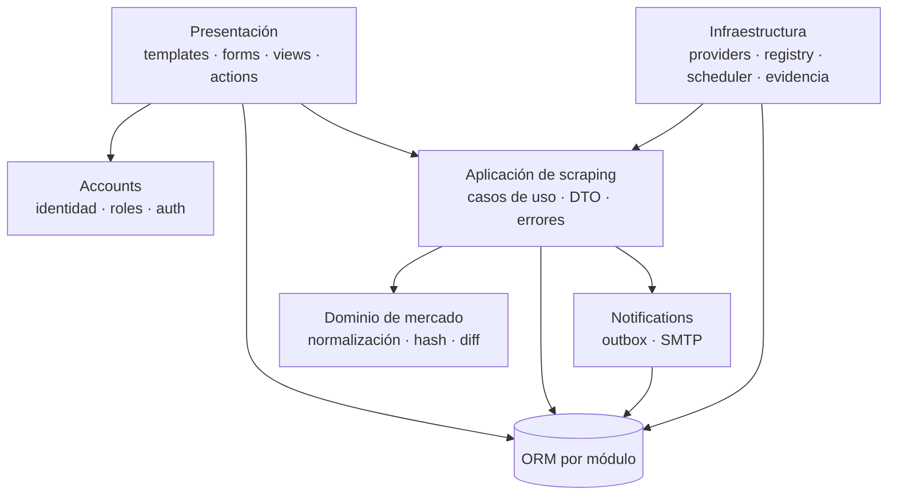
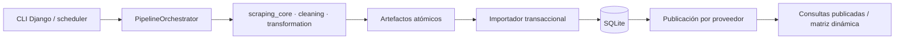
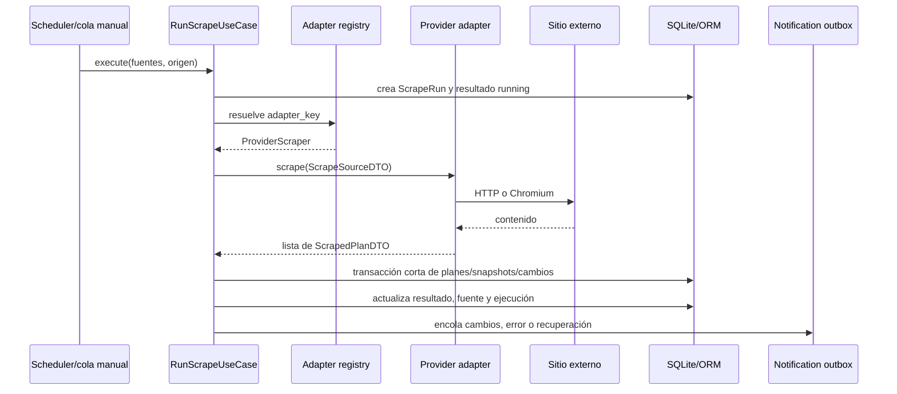
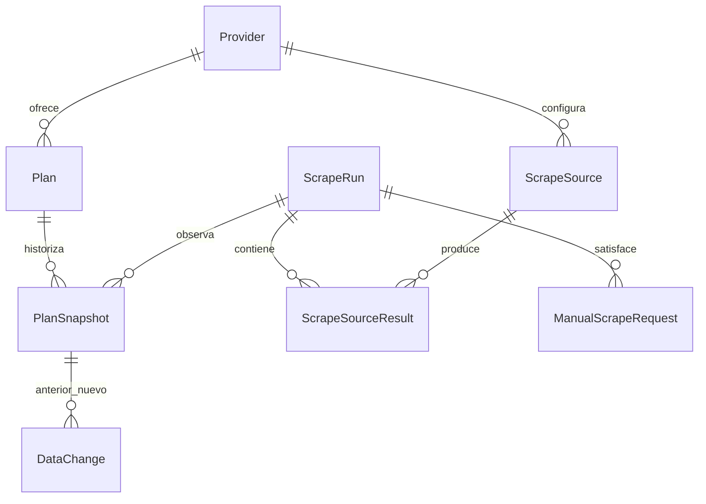
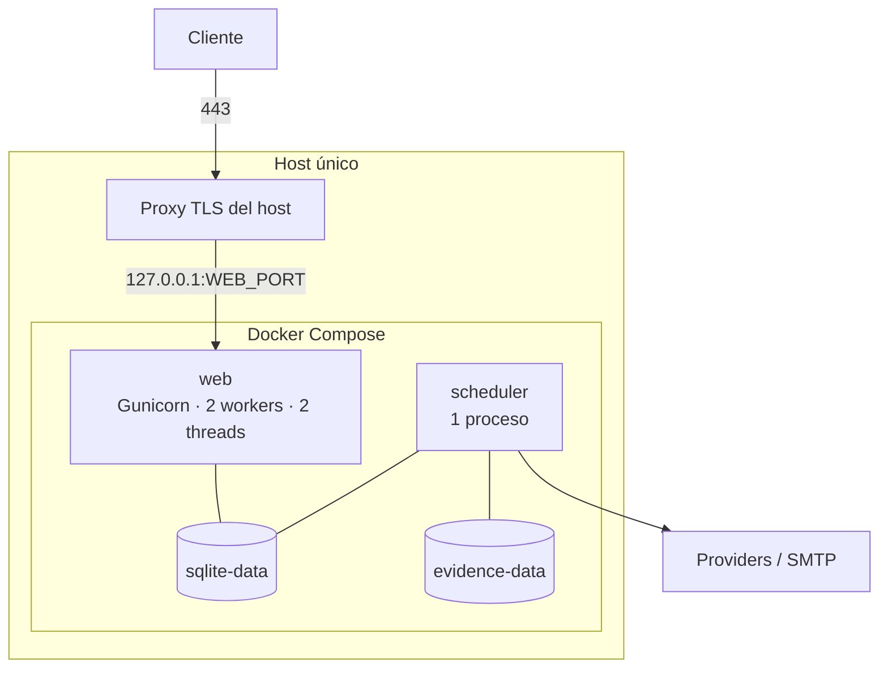

# Arquitectura

## Resumen

Market Watch es un monolito modular Django desplegado como dos procesos de la misma imagen: `web` atiende HTTP y `scheduler` ejecuta el pipeline secuencial, solicitudes manuales y notificaciones. Ambos comparten SQLite y el volumen de artefactos. Un proxy inverso TLS del host es la única entrada pública en producción: Nginx es la ruta canónica Linux y Windows requiere un proxy equivalente externo al stack Compose.

La organización toma ideas de arquitectura por capas sin fingir independencia total del framework: dominio puro donde aporta valor, casos de uso explícitos para el pipeline, infraestructura aislada para I/O y convenciones Django para identidad, ORM, formularios y vistas. Esta combinación mantiene bajo el coste operativo y deja comprobables los límites más sensibles.



## Objetivos y restricciones

El diseño busca:

- mantener la respuesta HTTP libre de scraping lento o navegador;
- conservar historial y explicar cada cambio detectado;
- soportar providers heterogéneos detrás de un contrato común;
- operar en un solo host con recursos moderados y sin broker;
- probar parsing, red y navegador contra fixtures locales;
- proteger la red interna y no persistir evidencia sensible sin saneamiento;
- permitir migrar persistencia y ejecución de trabajos cuando la escala lo justifique.

No busca por ahora alta disponibilidad multi-host, ingestión masiva, API pública ni una SPA. Esas necesidades cambiarían decisiones descritas en la [ruta de evolución](#ruta-de-evolución).

## Módulos y responsabilidades



### Accounts

Es dueño del usuario autenticado por correo y de la asignación de permisos. El signal `post_migrate` mantiene tres grupos base:

- **Administrador**: todos los permisos;
- **Operador**: lectura de mercado y permisos para encolar/ver el pipeline canónico;
- **Analista**: lectura de mercado.

El superusuario es el bootstrap operativo, no una cuenta predeterminada. Django admin sirve para administración profunda; la interfaz funcional aplica permisos y flujos específicos del producto.

### Market

Es dueño del proveedor compartido, la configuración del dashboard y varios modelos históricos de
planes. La presentación del dashboard consulta el esquema canónico de `pipeline` y sólo encola
ejecuciones completas; nunca obtiene sitios externos durante una petición HTTP.

### Scraping

Conserva fuentes, ejecuciones, resultados, agenda y solicitudes del flujo anterior, además del
heartbeat y la infraestructura del scheduler compartido. Sus catálogos y colas heredados no se
exponen ni se ejecutan automáticamente. Los adapters vigentes pertenecen al núcleo puro y se invocan
desde `apps.pipeline`.

El caso de uso recibe un resolver de adapters inyectable; su valor por defecto proviene del registro de infraestructura. Es un límite pragmático, no una arquitectura hexagonal estricta: conserva pruebas simples sin añadir contenedores de dependencias.

### Pipeline persistente

`apps.pipeline` es dueño de la operación nueva: fuentes ejecutables, configuraciones y perfiles
versionados, `PipelineRun`/`ProviderRun`/`StageRun`/`SourceRun`, artefactos, calidad y publicación.
Reutiliza sólo `market.Provider` como catálogo estable. Los modelos legados de planes, scraping y
reseñas se mantienen por relaciones y reportes históricos, pero el seed y el scheduler unificado no
dependen de ellos. La matriz de conservación está en
[Auditoría de módulos](data/LEGACY_MODULE_AUDIT.md).



La adquisición nunca ocurre dentro de una transacción. Cada fuente termina y cierra sus recursos,
luego escribe archivos; sólo después se importa un proveedor en una transacción corta. Una versión
de perfil fija las cuatro configuraciones exactas. La publicación es otra transacción y sólo cambia
el puntero lógico cuando planes, características, reseñas y fuentes requeridas terminaron.

Las identidades `MarketPlan`/`MarketReview` no son observaciones. Cada ejecución añade
`PlanSnapshot`/`ReviewSnapshot`; precios y características son relaciones largas. La evidencia
original (`PlanFeatureSource`) permanece separada del valor canónico tipado
(`PlanFeatureValue`). La descripción completa está en [Esquema persistente](data/PERSISTENCE_SCHEMA.md).

### Dashboard competitivo y ámbitos de datos

`market.Provider.data_scope` separa explícitamente datos `REAL` y `DEMO`; planes, observaciones y
ejecuciones heredan el ámbito por relaciones obligatorias. `DashboardPreset` modela vistas
globales ordenadas y `DashboardSettings` es el singleton tipado que concentra nombre, logotipos
principal/compacto, favicon, cabecera y vista predeterminada. Un context processor y callbacks de
Unfold comparten esa identidad entre portal, autenticación, correo y Admin; los archivos se sirven
por endpoints controlados, no mediante rutas de storage expuestas. “Todos” y “DEMO” son vistas de
sistema dinámicas: no materializan relaciones que quedarían obsoletas.

Los presets ordinarios guardan proveedores y, cuando corresponde, planes y características
canónicas mediante tablas intermedias. `feature_selection=all_current` significa resolución
dinámica; `explicit` usa relaciones a `FeatureDefinition`. La resolución distingue definiciones
disponibles para seleccionar de definiciones visibles por evidencia: `unknown` puro no aparece por
defecto, pero sigue seleccionable y una elección explícita del filtro o preset prevalece. La
resolución intersecta esas relaciones con los valores activos realmente publicados, por lo que una
característica ausente no causa un error ni se recrea. Los filtros temporales usan códigos estables
en la URL y nunca son autoridad.

La vista delega selección y analítica a `market.dashboard_service`. Ese servicio parte siempre del
último `ProviderRun` publicado por proveedor, construye el pivote de características desde la tabla
larga y aplica un mismo conjunto de planes a precios y matriz. El estado de una celda reduce la
disponibilidad de todos esos planes; el resumen visible elimina duplicados y el detalle conserva
plan, producto y valor/estado para no perder trazabilidad. Las reseñas siguen siendo métricas
del proveedor y esa independencia se explicita en la UI. Ningún arreglo de la maqueta visual forma
parte del runtime. Fórmulas, permisos y operación se detallan en [Dashboard competitivo](product/DASHBOARD.md).

La resolución pública de filtros conserva como autoridad el ámbito de la vista y la última
publicación. Los parámetros obsoletos o manipulados se descartan con aviso y redirección a una URL
canónica; las operaciones de escritura y el contrato interno conservan validación estricta.

Dashboard, Comparación y el reporte funcional de Reseñas comparten ese corte publicado. Comparación
lee `pipeline.MarketPlan`, snapshots, precios y valores largos; Reseñas lee `ReviewSnapshot` y su
identidad/fuente canónica. Los modelos `market.Plan*` y `reviews.MarketReview/ReviewObservation`
permanecen sólo para historial o compatibilidad y no alimentan esas pantallas ni sus exportaciones.

El ámbito `DEMO` es sólo una frontera de lectura visual. Orquestadores, importadores, publicación,
scheduler, fuentes legadas, exportación y notificaciones lo rechazan o excluyen antes de crear
trabajo. Las migraciones crean un snapshot sintético publicado sin activar fuentes ni encolar
eventos.

### Notifications

Es dueño de destinatarios y outbox. Los casos de uso encolan eventos persistentes con una clave idempotente; el scheduler envía SMTP y actualiza su estado. Así, una caída de correo no revierte datos de scraping ni obliga a repetir la captura externa.

## Capas y reglas de dependencia

| Capa | Puede conocer | No debería hacer |
| --- | --- | --- |
| Dominio (`market/domain`) | Tipos estándar y reglas puras. | Importar Django, acceder a red, reloj global, archivos u ORM. |
| Aplicación (`scraping/application`) | DTO, errores, modelos/casos colaboradores y puertos. | Conocer selectores HTML concretos o abrir navegadores directamente. |
| Infraestructura | Aplicación, modelos y servicios externos. | Introducir semántica de negocio duplicada dentro de adapters. |
| Presentación | Formularios, permisos, consultas y casos de uso/acciones. | Ejecutar scraping o SMTP inline en la petición web. |

Reglas prácticas:

1. Un provider transforma una fuente externa a `ScrapedPlanDTO`; no decide cómo persistir snapshots.
2. El dominio compara valores ya normalizados; no interpreta HTML.
3. El caso de uso coordina y persiste; no contiene selectores específicos de una marca.
4. Las vistas validan intención y permisos, y crean trabajo durable; el scheduler lo consume.
5. Las integraciones externas se sustituyen en pruebas mediante factories, transportes o fixtures.
6. Las transacciones contienen escrituras relacionadas, nunca esperas de red o navegador.

## Flujo de scraping



Para cada fuente:

1. Se registra un resultado en estado `running` y se realiza la adquisición fuera de una transacción larga.
2. El adapter valida el destino, aplica timeout/límites y devuelve DTO con el dato público puro. Sólo convierte los campos canónicos cuyo tipo o uso técnico lo exige; un fallo esperado se expresa como `ScrapeError` tipado.
3. En una transacción corta se obtiene o crea la identidad estable de cada plan y se calcula un hash del payload canónico.
4. Si el hash no cambió, no se crea otro snapshot. Si cambió, se guarda snapshot y `DataChange` con diff.
5. Un plan ausente sólo se retira después de tres capturas exitosas en las que falta. Un error o resultado sospechoso no debe borrar el último estado válido.
6. Se actualizan métricas y estado final de ejecución; los eventos se agregan a la outbox.

Esta estrategia separa **observación** de **estado derivado**: el snapshot es evidencia histórica inmutable y el plan es la vista actual navegable.

## Solicitud manual y scheduler

La UI canónica crea un `PipelineRun` manual pendiente; el scheduler lo reclama y ejecuta el perfil
activo completo. Las colas de captura anteriores permanecen inactivas. La agenda nocturna usa
`ScheduledJob` y esa misma versión. Además, el scheduler:

- publica heartbeat cada 15 segundos;
- consume una solicitud manual del pipeline cada 5 segundos;
- despacha notificaciones pendientes cada 10 segundos;
- programa cada `ScheduledJob` activo mediante su expresión cron;
- ejecuta planes de todos los proveedores, después características y finalmente reseñas, siempre
  una fuente a la vez;
- reintenta por fuente, conserva éxitos al reanudar y permite que otro proveedor continúe;
- usa `coalesce`, `max_instances=1` y tolerancia de ejecución tardía;
- adquiere un lock de archivo con `fcntl` para rechazar otro scheduler en el mismo host;
- recupera de forma segura una ejecución manual canónica pendiente.

La defensa tiene dos niveles: el lock evita duplicación accidental local y el estado persistente
hace recuperable cada unidad. Con SQLite se opera exactamente un scheduler. Un despliegue
distribuido requiere otra estrategia de exclusión y cola.

## Historial, cambios y retirada

Las entidades principales se relacionan conceptualmente así:



En la ruta nueva, las características variables se almacenan como definiciones y valores largos
tipados con disponibilidad `present`, `excluded`, `unknown` o `not_applicable`; la matriz ancha se
deriva bajo demanda. El JSON de características del esquema legado sólo permanece por
compatibilidad temporal.

## Notificaciones y consistencia

La outbox persistente desacopla el commit de negocio del SMTP:

1. el pipeline crea un evento con clave idempotente dentro de su flujo de persistencia;
2. el scheduler busca pendientes y envía a destinatarios habilitados;
3. éxito o error queda registrado para auditoría/reintento;
4. los fallos repetidos de una fuente se agrupan por ventana de cooldown;
5. la recuperación de una fuente genera un evento distinto.

No existe garantía transaccional distribuida con el servidor SMTP. La idempotencia impide duplicar eventos internos, pero un fallo después de que SMTP acepte el mensaje y antes de guardar el éxito puede producir reenvío; es el compromiso razonable sin un proveedor con claves idempotentes propias.

## Seguridad en los límites

- Autenticación por correo, CSRF de Django y autorización por permisos protegen la UI.
- `url_safety.py` limita esquemas y destinos para reducir SSRF; una URL sólo debe habilitarse después de validarla.
- Providers establecen timeout, tamaño/límites y reintentos acotados.
- La evidencia de navegador se sanea antes de persistir y vive fuera de static/media públicos.
- Configuración sensible llega por entorno; los ejemplos sólo contienen placeholders.
- En producción el proxy del host termina TLS, Gunicorn escucha en loopback a través del puerto publicado y Django aplica cookies/HSTS/proxy SSL. La ruta canónica usa Nginx en Linux; un host Windows debe aportar el mismo contrato de cabeceras y TLS.
- La evaluación local de la imagen productiva por HTTP requiere un argumento explícito, conserva el
  bind de loopback y recibe una marca Compose efímera; sin ella redirect y cookies productivas se
  mantienen seguros aunque `.env` contenga valores de desarrollo.
- La imagen final ejecuta un usuario sin privilegios y no incluye `node_modules` ni el toolchain frontend.

La explicación completa de amenazas y controles vive en [Seguridad](operations/SECURITY.md).

## Topología de ejecución



`web` y `scheduler` se construyen de la misma imagen para garantizar el mismo código y migraciones. Las migraciones se ejecutan como paso explícito antes de actualizar servicios; nunca se esconden en el arranque. El healthcheck consulta `/public/ready`, mientras que el heartbeat permite distinguir “web disponible” de “trabajos de fondo activos”.

Linux con Nginx/Certbot es la operación canónica desatendida. Windows puede ejecutar los mismos
contenedores Linux mediante Docker Desktop, pero el proxy TLS y el arranque automático de Docker
son responsabilidades externas al stack. En ambos casos Compose sólo publica Gunicorn en
`127.0.0.1`.

En desarrollo nativo, `runserver` y `run_scheduler` son procesos separados que comparten la base configurada en `.env`. En Compose usan volúmenes nombrados, por lo que son almacenes distintos; la guía de [Desarrollo](development/DEVELOPMENT.md) explica cómo detenerlos sin eliminar datos.

## Justificación de la arquitectura

### Monolito modular

La UI, los casos de uso y los datos cambian juntos y pertenecen al mismo equipo/producto. Un monolito permite transacciones locales, migraciones únicas y despliegue sencillo. Los módulos y reglas de dependencia preservan claridad sin pagar coordinación de APIs, observabilidad distribuida ni consistencia eventual de microservicios.

### Proceso de fondo separado

El scraping es lento, falible y a veces abre Chromium. Separarlo del servidor web evita bloquear workers HTTP, duplicar jobs al escalar Gunicorn y mezclar reinicios de atención con ejecución programada.

### SQLite con disciplina transaccional

Para una instancia y pocas escrituras, SQLite reduce componentes, backups y fallos operativos. WAL, espera ocupada, transacciones cortas y un único scheduler mitigan su principal límite. No se intenta hacer pasar esta elección por una base distribuida.

### Renderizado de servidor

El producto es una aplicación interna de tablas, formularios y gráficos puntuales. Django Templates y mejoras progresivas entregan menos código cliente, autenticación directa y despliegue autocontenido. HTMX y Chart.js están disponibles donde su beneficio es concreto.

### Outbox sin broker

Persistir intención de correo conserva auditabilidad y reintento sin hacer que SMTP forme parte de la transacción. El scheduler ya existente puede despacharla; añadir broker/worker sólo se justifica cuando el volumen o aislamiento lo exijan.

Las decisiones y alternativas originales se conservan como ADR en [Decisiones](DECISIONS.md).

## Ruta de evolución

| Señal | Evolución esperada |
| --- | --- |
| Contención frecuente, más de un scheduler/host o réplicas web que escriben | Migrar a PostgreSQL, revisar locking y probar índices/consultas con datos reales. |
| Cola creciente, providers largos o necesidad de paralelismo controlado | Introducir un broker y workers; mantener los casos de uso y adapters como unidades de trabajo. |
| Evidencia grande o workers en varios hosts | Mover evidencia a almacenamiento de objetos con retención y cifrado. |
| Consultas analíticas frecuentes sobre características | Normalizar las dimensiones consultadas o alimentar un almacén analítico. |
| API pública o múltiples clientes | Añadir una capa API explícita sin exponer modelos ORM directamente. |
| Requisitos de alta disponibilidad | Externalizar base/evidencia, eliminar locks locales y diseñar idempotencia distribuida. |
| Interacciones cliente complejas y estado rico | Evaluar componentes o SPA sólo para esas superficies, manteniendo servidor donde sea simple. |

Estas migraciones deben responder a mediciones o requisitos, actualizar un ADR y conservar pruebas de contrato del pipeline.

## Núcleo compartido y CLI sin base de datos

Los DTO, conversiones canónicas indispensables, seguridad y adapters de adquisición viven en `scraping_core`, por debajo de Django. Los campos originales y `raw_payload` conservan lo observado sin limpieza; `apps.scraping` y `apps.reviews` los adaptan a persistencia y settings, y `scraper_cli` a TOML y CSV/JSON sin una segunda normalización. Ningún import puede ir desde esos dos paquetes independientes hacia `apps`, settings, modelos u ORM. El builder comprueba el grafo con AST y ejecuta la copia fuera del repositorio. Consulta [Arquitectura CLI](cli/CLI_ARCHITECTURE.md).

El procesamiento posterior es deliberadamente externo al scraper. `data_cleaning` corrige calidad,
elimina columnas totalmente vacías y aplica políticas numéricas explícitas;
`data_transformation` conserva hechos observados y crea tipos, auxiliares y derivados analíticos.
Ambos dependen del paquete neutral `data_pipeline`, que contiene perfiles, detección, políticas,
reportes e I/O. Ninguno depende de Django, persistencia o red. Esta dirección evita que una regla
analítica altere el dato raw y permite reprocesar archivos históricos. La orquestación por lotes
también vive en el límite CLI compartido:
descubre archivos, detecta cada tipo y concatena cada grupo antes de llamar una sola vez a la API
tabular de la etapa; así esas APIs permanecen pequeñas y reutilizables. Consulta
[Pipeline de datos](data/DATA_PIPELINE.md).

El reporte de calidad es salida lateral y nunca alimenta cálculos. La tabla de características larga
es canónica; su vista ancha es un artefacto derivado que deja nulas las colisiones. Los contratos
`plans_v2`, `plan_features_v1` y `reviews_v1` describen la capa raw del scraper, mientras la capa
analítica puede sumar columnas normalizadas y métricas sin sobrescribir los campos observados.

El aplanado de características tiene un solo punto de selección en `data_transformation`: sin
configuración usa el pivote dinámico compatible; con una configuración v1 validada delega en
`data_transformation.feature_rules`. El motor separa columnas, reglas y derivados; evalúa regex
compiladas, reduce aportes por plan y produce un reporte lateral. No importa Django, no ejecuta
código de configuración y no modifica la tabla larga. El ejemplo y JSON Schema viven en
`feature_rules/` y se copian al distribuible CLI.

## Verificación de límites

- Las reglas puras tienen pruebas unitarias sin Django/red.
- Los providers usan fixtures locales y transports falsos; Playwright está marcado por separado.
- Los tests ORM validan unicidad, snapshots, retirada, leases y outbox.
- Los tests de presentación verifican login, permisos, formularios, tema y navegación.
- `make lint`, `make test`, `make assets`, `make test-playwright` y `make build` se agrupan secuencialmente en `make verify`.
- `make docs-check` verifica que esta referencia continúe enlazada y que los enlaces locales resuelvan.

Para ubicar el código de cada responsabilidad, consulta [Estructura del repositorio](REPOSITORY_STRUCTURE.md).

## Pipeline de reseñas y respuestas

`apps.reviews` es un dominio hermano del scraping de planes. Reutiliza el proceso scheduler, permisos, validación SSRF y outbox, pero mantiene DTO, registro, ejecución y persistencia propios.

```text
Provider.code -> ReviewSource -> adapter registrado -> ScrapedReviewDTO
              -> MarketReview -> ReviewObservation -> ReviewEnrichment
```

`Provider.code` es `competidor_id`; `adapter_key` identifica código y puede repetirse entre providers. Una solicitud web sólo crea `ManualReviewRequest`. El scheduler procesa secuencialmente, usa lease, limita páginas/registros, revisa una ventana reciente y avanza el cursor después del commit. Una fuente fallida no cancela las restantes.

La identidad prefiere el ID externo namespaced; el fallback SHA-256 versionado combina fuente, entidad, fecha, autor, rating y texto. El hash de observación incluye likes y respuesta, por lo que un cambio crea historial sin duplicar contenido idéntico. Categoría y sentimiento nacen nulos; un job separado crea resultados versionados. Consulta [fuentes de reseñas](development/ADDING_A_REVIEW_SOURCE.md) y [esquema CSV](data/REVIEW_CSV_SCHEMA.md).

Este flujo se conserva como legado de captura y enriquecimiento, pero no se ejecuta automáticamente
ni alimenta el portal. La pantalla y exportaciones vigentes proyectan el contrato equivalente desde
el pipeline canónico; los campos que éste no obtiene se mantienen nulos en vez de inventarse.
