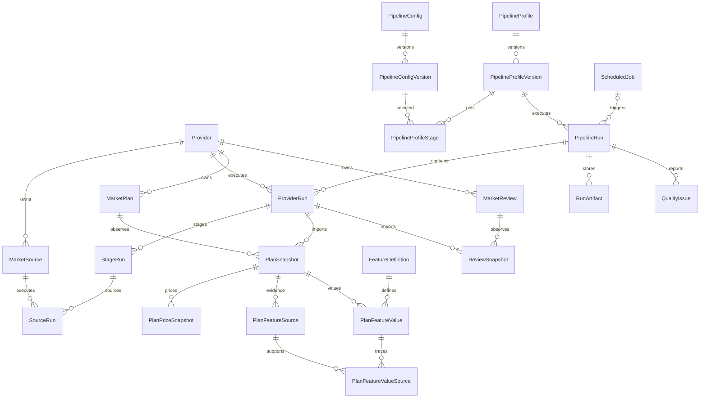

# Persistencia histórica del pipeline

## Alcance

La fuente operativa nueva vive en la aplicación Django `pipeline`. Reutiliza únicamente
`market.Provider` como catálogo estable de competidores y no depende de `market.Plan`,
`scraping.ScrapeRun`, `reviews.ReviewRun` ni de sus snapshots anteriores. Esas tablas legadas se
conservan durante la transición de las pantallas existentes, pero el scheduler unificado, los
comandos nuevos, la importación y la publicación escriben y consultan el esquema descrito aquí.

Esta estrategia es aditiva: permite crear SQLite desde cero con toda la historia de migraciones y
evita una migración de datos que el proyecto no necesita. La base local anterior se conserva como
backup recuperable antes de recrear `data/market-watch.sqlite3`.

## Relaciones

## Identidad y observaciones

- `MarketPlan` identifica un plan por `(provider, external_key)`. Una ejecución nueva agrega un
  `PlanSnapshot`; no crea otra identidad.
- `MarketReview` identifica una reseña por `(provider, platform_code, external_review_id)`. El
  cambio de texto, respuesta o calificación produce otro `ReviewSnapshot`.
- `ProviderRun` es la unidad de publicación. Sólo puede publicarse cuando sus etapas y fuentes
  requeridas terminaron correctamente. Una ejecución parcial nunca desplaza el último conjunto
  publicado de ese proveedor.
- `PlanSnapshot` conserva nombre, producto, URL y promoción. Las modalidades monetarias viven en
  `PlanPriceSnapshot` con `DecimalField` y `source_kind` scraped/calculated.

## Características

`PlanFeatureSource` conserva cada fila observada. `FeatureDefinition` define el contrato de un
valor y distingue alcance `canonical` de `provider`. Las claves producidas por fallback siempre
incluyen el proveedor en su identidad lógica y nunca se vuelven comparables por coincidencia de
texto accidental.

`PlanFeatureValue` usa exactamente uno de `value_boolean`, `value_integer`, `value_decimal`,
`value_text` o `value_json`. `availability` distingue `present`, `excluded`, `unknown` y
`not_applicable`; `origin` distingue `rule`, `fallback`, `derived` y `default`. Por ello un cero
configurado puede conservarse como valor de presentación sin confundirse con una observación
explícita: su origen es `default` y su disponibilidad puede ser `unknown`.

La relación `PlanFeatureValueSource` mantiene la evidencia usada por cada reducción. La vista
ancha se construye desde valores largos; añadir una característica no altera SQLite.

## Configuraciones

`PipelineConfigVersion` guarda JSON canónico, SHA-256, versión de schema y estado. Una versión
publicada es inmutable. `PipelineProfileVersion` queda también inmutable al publicarse y
`PipelineProfileStage` fija versiones concretas para extracción, limpieza, normalización y
equivalencias. `PipelineRun` referencia esa versión exacta, nunca “la activa”.

Secretos no forman parte del contenido permitido. Cookies, contraseñas, tokens, claves SMTP y API
keys continúan en entorno o gestor externo.

## Ejecución, artefactos y calidad

El orden es una barrera estricta: todos los proveedores de planes, luego características y por
último reseñas. Dentro de cada etapa se ordena por proveedor, fuente y `execution_order`; no hay
workers paralelos. Los reintentos pertenecen a `SourceRun` y usan backoff acotado fuera de
transacciones.

`RunArtifact` sólo guarda ruta relativa segura, hash y tamaño bajo `PIPELINE_ARTIFACT_ROOT`.
`QualityIssue` traduce incidencias útiles y los reportes completos quedan además como artefactos.
No se guardan blobs grandes en SQLite.

## SQLite

Django activa claves foráneas, `busy_timeout=20000` y WAL mediante el hook existente. WAL es
adecuado al único host y scheduler; no habilita múltiples escritores del pipeline. Las
transacciones contienen importaciones breves y publicación, nunca navegación HTTP o Playwright.

