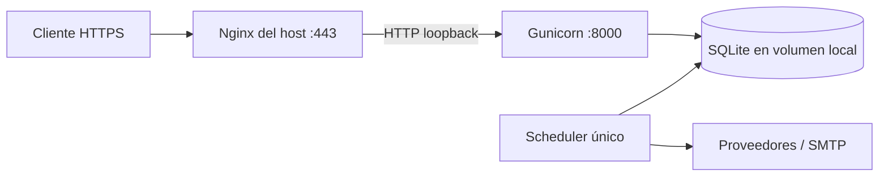

# Despliegue a producción con Nginx

Este procedimiento se ejecuta en un servidor **Linux**: Nginx, systemd, sockets Unix y las rutas
`/srv/...` no tienen equivalentes directos en Windows. Windows sí puede usarse para desarrollar,
operar la CLI o administrar el host por SSH; consulta [Producción desde cero](PRODUCTION.md) y
[Linux y Windows](../development/WINDOWS_LINUX.md).

La topología recomendada para una sola máquina es:



Nginx y Certbot se ejecutan en el host. Docker publica Gunicorn únicamente en `127.0.0.1`; SQLite y evidencia viven en volúmenes persistentes. Nginx sirve como terminación TLS y proxy; WhiteNoise entrega los assets versionados a través de Gunicorn.

## 1. Requisitos del servidor

- Una máquina Linux con disco local; no ubiques SQLite en NFS.
- Docker Engine y Compose v2.
- Nginx, Certbot y el plugin o modo webroot disponible.
- DNS `A/AAAA` del dominio apuntando al servidor.
- Firewall con 22 (restringido), 80 y 443 abiertos; el puerto 8000 no debe exponerse externamente.
- Usuario de servicio sin privilegios, por ejemplo `market-watch`, con acceso a Docker.

Ejemplo Debian/Ubuntu:

```bash
sudo apt update
sudo apt install nginx certbot openssl
sudo install -d -o www-data -g www-data /var/www/letsencrypt
sudo install -d -m 0755 /etc/nginx/tls
```

Clona el repositorio en una ruta estable como `/opt/market-watch`. Los despliegues posteriores deben usar siempre esa misma ruta para que Compose conserve el nombre de proyecto y sus volúmenes.

## 2. Configuración de producción

```bash
cp .env.production.example .env
chmod 600 .env
```

Genera `SECRET_KEY` fuera del historial:

```bash
python3 -c 'import secrets; print(secrets.token_urlsafe(64))'
```

Reemplaza el dominio de ejemplo y configura SMTP. Valores obligatorios:
Reemplaza el mismo dominio en `deploy/nginx-bootstrap.conf` y `deploy/nginx.conf`; el chequeo exige que `server_name` coincida con `ALLOWED_HOSTS`.
Consulta la [referencia completa de variables](../development/ENVIRONMENT_VARIABLES.md) para tipos,
defaults, correo, rutas persistentes y valores que los settings productivos fuerzan.

```dotenv
DEBUG=false
ALLOWED_HOSTS=market-watch.example.com
CSRF_TRUSTED_ORIGINS=https://market-watch.example.com
APP_BASE_URL=https://market-watch.example.com
DATABASE_PATH=/app/data/market-watch.sqlite3
PIPELINE_ARTIFACT_ROOT=/app/data/pipeline
MEDIA_ROOT=/app/media
SECURE_SSL_REDIRECT=true
SESSION_COOKIE_SECURE=true
CSRF_COOKIE_SECURE=true
SCRAPER_ALLOW_PRIVATE_HOSTS=false
```

Empieza con `SECURE_HSTS_SECONDS=3600`. Activa subdominios/preload solo después de confirmar que todos los subdominios usan HTTPS permanentemente.

Valida sin desplegar:

```bash
scripts/deploy-production.sh --check
```

`--apply` rechaza placeholders, claves cortas, `DEBUG=true`, cookies inseguras, HTTP en CSRF y wildcards en hosts.

## 3. Primer arranque de la aplicación

```bash
scripts/deploy-production.sh --apply
docker compose ps
curl http://127.0.0.1:8000/public/ready
docker compose run --rm web python manage.py createsuperuser
```

El script construye con concurrencia 1, etiqueta la imagen con el commit actual, aplica migraciones una sola vez, arranca web/scheduler y espera readiness. No arranca Mailpit.

Antes de continuar, confirma que `docker compose ps` muestra web `healthy` y un solo scheduler.
Si usarás el pipeline persistente, siembra su configuración idempotente:

```bash
docker compose run --rm web python manage.py seed_market_pipeline
```

## 4. Certificado inicial

Con el `server_name` ya ajustado y validado, copia la configuración HTTP:

```bash
sudo cp deploy/nginx-bootstrap.conf /etc/nginx/sites-available/market-watch.conf
sudo ln -s /etc/nginx/sites-available/market-watch.conf /etc/nginx/sites-enabled/market-watch.conf
sudo nginx -t
sudo systemctl reload nginx
```

Solicita el certificado mediante webroot:

```bash
sudo certbot certonly --webroot -w /var/www/letsencrypt -d market-watch.example.com
sudo ln -s /etc/letsencrypt/live/market-watch.example.com/fullchain.pem /etc/nginx/tls/fullchain.pem
sudo ln -s /etc/letsencrypt/live/market-watch.example.com/privkey.pem /etc/nginx/tls/privkey.pem
```

Si los enlaces ya existen, revísalos; no los reemplaces a ciegas. Certbot actualiza los archivos destino durante la renovación.

## 5. Activar Nginx TLS

Instala la configuración TLS ya ajustada y valida antes de recargar:

```bash
scripts/check-nginx-config.sh
sudo cp deploy/nginx.conf /etc/nginx/sites-available/market-watch.conf
sudo nginx -t
sudo systemctl reload nginx
curl -fsS https://market-watch.example.com/public/ready
```

El archivo incluye:

- redirección HTTP→HTTPS sin bloquear ACME;
- TLS 1.2/1.3 y HSTS inicial de una hora;
- forwarding correcto de host, IP y protocolo para Django;
- rate limit conservador sobre login;
- timeout del proxy superior al de Gunicorn;
- caché para assets con hash;
- endpoints de salud sin logs de acceso.

Comprueba renovación:

```bash
sudo certbot renew --dry-run
```

Configura un deploy hook de Certbot que ejecute `systemctl reload nginx` tras una renovación válida.

## 6. Actualizar código y assets

Los assets se editan únicamente en `frontend/`. El `Dockerfile` instala el lock de pnpm y ejecuta
el build; por tanto `scripts/deploy-production.sh --apply` vuelve a generar `src/static/dist/`
dentro de la imagen junto con el código de la release. No compiles manualmente sobre el contenedor
activo ni edites `src/static/dist/`.

Con el código deseado ya revisado en el host Linux:

```bash
git status --short
git pull --ff-only
scripts/deploy-production.sh --check
scripts/deploy-production.sh --apply
docker compose ps
docker compose logs --no-color --tail=100 web scheduler
```

Este mismo procedimiento es obligatorio si el único cambio fue visual. Comprueba en el navegador
que los nombres versionados nuevos se sirven correctamente. Si administras un host Linux desde
Windows, conéctate por SSH y ejecuta estos comandos allí. Para un runtime alojado en Windows usa el
aplicador PowerShell y proxy TLS descritos en [Producción desde cero](PRODUCTION.md#ruta-windows-con-docker-desktop),
no esta configuración Nginx.

Si web ya estaba activo, el script crea un backup consistente antes de migrar. Copia regularmente los backups fuera del volumen y del servidor. El despliegue mantiene dos procesos web de Gunicorn y una sola instancia de scheduler.

No ejecutes migraciones desde `web` y `scheduler` simultáneamente. No uses `docker compose down -v` en producción.

## 7. Backup externo y restauración

Crear un backup en el volumen:

```bash
docker compose exec -T web python manage.py backup_sqlite
```

El comando imprime la ruta resultante. Cópiala fuera del volumen:

```bash
docker compose cp web:/app/data/backups/market-watch-FECHA.sqlite3 /srv/backups/market-watch/
```

La imagen de marca del dashboard está fuera de SQLite en el volumen `media-data`. Respáldalo en la
misma ventana, por ejemplo mediante un contenedor efímero que monte el volumen en sólo lectura y un
directorio de backup del host. No expongas `/media/` directamente en Nginx: la imagen configurada
se entrega por un endpoint autenticado y el fallback vive en static. Verifica el archivo resultante
antes de retirar backups anteriores.

Para restaurar, programa una ventana, detén web/scheduler, conserva la base actual, coloca una copia verificada en la ruta de `DATABASE_PATH`, ejecuta `PRAGMA integrity_check`, aplica migraciones y arranca primero web. El procedimiento detallado está en [Operación](OPERATIONS.md).

## 8. Rollback

El script etiqueta cada build con `IMAGE_TAG` (por defecto, el hash Git). Conserva las imágenes de al menos dos releases.

Rollback de código sin revertir esquema:

```bash
IMAGE_TAG=HASH_ANTERIOR docker compose up -d --no-build web scheduler
docker compose ps
curl -fsS https://market-watch.example.com/public/ready
```

Si la release aplicó una migración incompatible, no bajes código sobre el esquema nuevo. Detén servicios y restaura conjuntamente la imagen anterior y el backup previo. Documenta y ensaya este procedimiento antes de una migración destructiva.

## 9. Observabilidad y operación

```bash
docker compose ps
docker compose logs --no-color --tail=200 web scheduler
curl -fsS https://market-watch.example.com/public/health
curl -fsS https://market-watch.example.com/public/ready
sudo journalctl -u nginx --since today
```

Alertas mínimas recomendadas:

- readiness distinto de 200;
- contenedor reiniciándose;
- heartbeat del scheduler antiguo;
- crecimiento de errores/outbox;
- poco espacio en disco o backups ausentes;
- expiración TLS próxima.

Consulta [Seguridad](SECURITY.md), [Uso de recursos](RESOURCE_USAGE.md) y [Operación](OPERATIONS.md).
